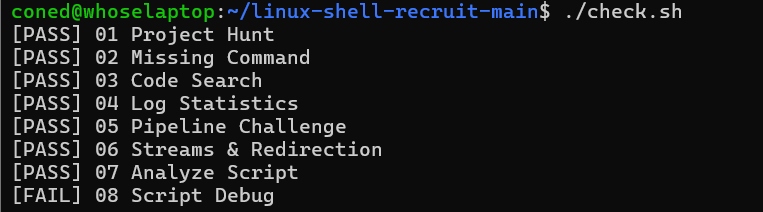

# 常用linux指令
## 1.pwd :打印你当前所在文件夹的完整路径  
## 2.ls:列出当前目录下的文件  
## 3.cd:切换文件夹  
## 4.find:递归查找文件，用来在文件夹里搜索文件(包括隐藏文件)  
## 5.grep：搜索文件里面的内容  
## 6.cat:查看一个文件里面的全部内容  
## 7.echo:输出一段文本或将文本写入文件(>：重定向输出，文件不存在时会创建文件；文件已存在时会覆盖原有内容。>>：追加输出，不会覆盖原有内容。)  
## 8.export:给当前 shell 会话设置环境变量，**临时生效**  
## 9.sort:做字典序排序  
## 10.uniq：删除相邻重复，只保留一份  
## 11.awk:文本处理语言，按行处理，把一行切分成若干字段（列）
uniq -c:"‑c" = count，统计每一行重复多少次
## 11.wc: “word count”统计文本的行数、单词数、字节数。
## 12.stdout（标准正常输出，文件描述符 1）
## 13.stderr（标准错误输出，文件描述符 2）
## 常用技巧  
1.管道：“I”  
2.[^ ]*：用来提取空格前的一整段文字
# 每题判定情况

其中第八题在列出backup文件夹时能看待“My Report.txt”和“report.txt”，尝试多次后还是不知道为什么无法通过
